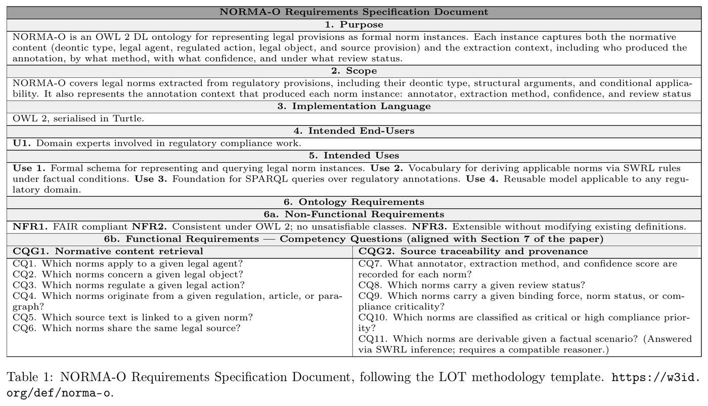

# NORMA-O: The NORMA Ontology for Legal Norm Annotations

[](https://doi.org/10.5281/zenodo.24116269)
[](https://doi.org/10.5281/zenodo.19765301)
[](https://www.w3.org/TR/owl2-overview/)
[](https://creativecommons.org/licenses/by/4.0/)
[](https://w3id.org/def/norma-o)
[](https://zenodo.org/communities/norma)

**NORMA-O** is an OWL 2 DL ontology for representing legal norms as machine-readable, interoperable knowledge. It describes what a norm requires, forbids or allows, under which conditions, for whom and on which legal source it rests, and, since version 2.0, how norms relate to each other, which legal positions they create, how they defeat one another and what applies in a concrete case. Every statement stays traceable to its legal source and to the process that produced it.

> **IRI:** `https://w3id.org/def/norma-o`  
> **Version IRI:** `https://w3id.org/def/norma-o/2.0` (current) · `https://w3id.org/def/norma-o/1.0` (previous)  
> **Preferred prefix:** `norma`  
> **Derivation module:** `https://w3id.org/def/norma-o/deriv` (prefix `normad`)  
> **DOI (2.0):** [10.5281/zenodo.24116269](https://doi.org/10.5281/zenodo.24116269)  
> **Documentation:** [w3id.org/def/norma-o](https://w3id.org/def/norma-o) · [What's new in 2.0](release/2.0.0/WHATS-NEW.md)

---

## Research context

NORMA-O is part of ongoing research on how legal norms can be represented so that machines can store, query and reason over them without losing the nuance that makes them legal: their conditions, their exceptions, the parties they bind and the authority they rest on. The ontology is not tied to a particular authoring tool, notation or regulation; any process that produces norm annotations, whether manual, automated or mixed, can publish them with it.

The work is developed in versions, each extending the previous one without breaking it:

| Version | Research question | Contribution |
|---|---|---|
| **1.0** | How can a norm and its legal context be published as structured, traceable data? | Deontic types, constitutive rules, conditions and their outcomes, agents, actions, objects and sources, annotation provenance and controlled vocabularies, designed for norms annotated on BPMN models of regulatory processes |
| **2.0** | What can be derived from a body of norms, and why? | Deontic logic grounding, Hohfeldian positions, roles and cases, defeasibility and prevalence, counts-as chaining, and a derivation module recording how and under which assumptions each conclusion was obtained |

In 1.0, norms were annotated on BPMN models of regulatory processes: gateways carried the legal conditions, their outgoing branches the condition outcomes, and the annotated elements the norms they activate. The trigger-event pattern and several 1.0 term descriptions come from that setting. Version 2.0 keeps the same model but describes it independently of BPMN, so that norms can be represented whatever notation or method produced them.

Future versions will continue along this line. Open questions, such as temporal validity, richer modelling of discretion and interpretation, and cross-jurisdiction alignment, are listed among the [known limitations](release/2.0.0/WHATS-NEW.md#9-known-limitations) of 2.0.

### Relation to the NORMA toolkit

NORMA-O originated within the **NORMA project**, whose [semantic toolkit](https://github.com/sheyls/norma-semantic-toolkit) uses it as its schema to annotate regulations, build RDF graphs and evaluate compliance. The toolkit is one producer and consumer of NORMA-O, not a requirement: the ontology defines no dependency on it, and the few term descriptions that mention it do so only as an example of use.

---

## What's new in 2.0

Version 2.0 keeps every term of 1.0 and adds the means to state how norms relate to each other and to concrete cases, and to compute what applies, to whom and why:

- **Standard Deontic Logic grounding** — action negation (`isNegationOf`), `Facultative`, `WeakPermission`, and deontic equivalence, contradiction and conflict between norms.
- **Hohfeldian legal positions** — `Duty`, `Claim`, `Privilege` and `NoRight`, with holder, counterparty, correlatives and jural opposites.
- **Roles, parties and cases** — `LegalRole`, `LegalParty`, `RoleAssignment`, `FactPattern`, and `confersRole` for constitutive rules.
- **Defeasibility** — `ExceptionDefeater`, `ConflictDefeater` and `TemporalDefeater`; lex superior, specialis and posterior; normative rank; norm strength; and a prevalence digraph.
- **Counts-as chaining** — `establishesTrigger` lets a constitutive rule establish an institutional fact that conditions regulative norms, so that defeating a classification (e.g. the high-risk classification of the AI Act) withdraws every obligation that depends on it.
- **Derivation module and reference rule set** — the `normad` module and [`deriv/`](release/2.0.0/deriv/) compute the deontic closure, positions, prevalence ordering with cycle detection, per-case applicability and weak permissions.

`norma:exception` is deprecated and `norma:UnderReview` moved to `ReviewStatus`. See [What's new in 2.0](release/2.0.0/WHATS-NEW.md) for the full description, migration guide, worked examples, term catalogue and known limitations.

---

## Table of Contents

- [NORMA-O: The NORMA Ontology for Legal Norm Annotations](#norma-o-the-norma-ontology-for-legal-norm-annotations)
  - [Research context](#research-context)
    - [Relation to the NORMA toolkit](#relation-to-the-norma-toolkit)
  - [What's new in 2.0](#whats-new-in-20)
  - [Table of Contents](#table-of-contents)
  - [Overview](#overview)
  - [Methodology: LOT](#methodology-lot)
  - [Competency Questions](#competency-questions)
  - [Ontology Diagram](#ontology-diagram)
  - [Scope](#scope)
  - [Principal Classes](#principal-classes)
  - [Derivation module and rule set](#derivation-module-and-rule-set)
  - [Statistics](#statistics)
  - [Alignments](#alignments)
  - [Downloads](#downloads)
  - [Ontology Requirements Specification Document](#ontology-requirements-specification-document)
  - [Citation](#citation)
  - [License](#license)
  - [Related resources](#related-resources)

---

## Overview

Regulatory requirements are increasingly expected to be machine-readable: traceable to their legal source, classifiable by type and binding force, and queryable in automated compliance pipelines. NORMA-O provides a semantic model for this, so that legal knowledge engineers, researchers and developers can publish normative content as structured, interoperable RDF graphs and reason over it.

The ontology models normative content together with the legal context needed to interpret it. It distinguishes between regulative norms (obligations, prohibitions, permissions, recommendations, negative recommendations) and constitutive rules (definitional or classificatory statements), and represents each legal element — agent, action, object, condition, source — as a distinct entity rather than a free-text blob.

Four design principles shape the model:

1. **Explicit conditional applicability** — a `norma:TriggerEvent` links a specific condition outcome to the normative content it activates, following the W3C n-ary relation pattern. This makes branch-sensitive activation queryable rather than buried in unstructured text.
2. **Reuse of established standards** — PROV-O for annotation provenance, ELI for legal resource references, FOAF for agent metadata, and SKOS for controlled classification values.
3. **First-class provenance** — the ontology records not only what a norm says, but who produced the annotation, by what method, and with what review status.
4. **Explainable derivation** (2.0) — derived conclusions are kept apart from asserted ones and record the rules and assumptions that produced them, so every result can be traced back and questioned.

---

## Methodology: LOT

NORMA-O was developed following the **LOT (Linked Open Terms) methodology** for ontology engineering. LOT is an industrial ontology development process that provides a systematic workflow for building OWL ontologies aligned with Linked Data best practices.

| LOT Activity | Output in NORMA-O |
|---|---|
| Requirements specification | Competency questions (see below), extended in 2.0 |
| Conceptualisation | Conceptual model — classes, relations, controlled vocabularies |
| Implementation | OWL 2 DL axiomatisation in Turtle and RDF/XML |
| Publication | Persistent IRI (`w3id.org/def/norma-o`), WIDOCO HTML documentation via OnToology, Zenodo release with DOI |
| Evaluation | SPARQL-based CQ evaluation against an EU AI Act ABox; in 2.0 also HermiT consistency and satisfiability checks, OOPS! pitfall scan and 140 automated derivation checks |

> **Reference:** Poveda-Villalón, M., Gómez-Pérez, A., & Suárez-Figueroa, M. C. (2022). LOT: An industrial oriented ontology engineering framework. *Engineering Applications of Artificial Intelligence*, 111, 104755. https://doi.org/10.1016/j.engappai.2022.104755

---

## Competency Questions

The following competency questions (CQs) guided the ontology design and serve as evaluation criteria. Each CQ can be answered by a SPARQL query over an ABox that instantiates NORMA-O.

| ID | Competency Question |
|---|---|
| CQ1 | What type of normative content does a given annotation represent — a regulative norm (obligation, prohibition, permission, recommendation, or negative recommendation) or a constitutive rule? |
| CQ2 | Under which conditions does a norm apply, and which specific condition outcome activates it? |
| CQ3 | Who is the legal agent bearing the obligation, right, or restriction stated by a norm? |
| CQ4 | What action is required, prohibited, or permitted under the norm? |
| CQ5 | What legal object does the regulated action concern? |
| CQ6 | From which legal source (regulation, directive, article, paragraph) does the norm derive? |
| CQ7 | Who produced the annotation, by which method (manual, automated, semi-automated), and under what review status? |
| CQ8 | What is the binding force (hard law, soft law) and compliance criticality (high, medium, low) of a norm? |
| CQ9 | What is the current lifecycle status of a norm (active, superseded, repealed)? |
| CQ10 | Which normative statements are activated when a given condition outcome holds? |

Version 2.0 adds the following questions:

| ID | Competency Question |
|---|---|
| CQ11 | Do two provisions state the same thing in different words? |
| CQ12 | Do two norms contradict each other, or are they merely incompatible? |
| CQ13 | Which duties, claims, privileges and no-rights does each party hold, and toward whom? |
| CQ14 | Does a norm reach a given party, given the role it occupies in a case? |
| CQ15 | In a given case, which norms apply once exceptions, conflicts and repeals are taken into account? |
| CQ16 | Why does a norm not apply in a given case? |
| CQ17 | If a classification is defeated, which obligations that depend on it fall with it? |
| CQ18 | What is the prevalence hierarchy of a body of norms, and does it contain cycles? |
| CQ19 | May an agent perform an action because nothing forbids it? |
| CQ20 | Under which rules and assumptions was a derived conclusion computed? |

---

## Ontology Diagram

The diagram below shows the principal classes and object properties of NORMA-O 2.0. The 1.0 diagram is [here](release/1.0.0/norma-o.svg), and the derivation module's diagram [here](release/2.0.0/norma-o-deriv-v1.svg).


*Diagram generated with [diagrams.net](https://www.diagrams.net/).*

---

## Scope

The ontology covers the following aspects of legal norm annotations:

- **Regulative norms** — obligations, prohibitions, permissions, recommendations, and negative recommendations
- **Constitutive rules** — statements that define statuses, classifications, or institutional facts
- **Legal conditions and their evaluated outcomes** — including branch-sensitive activation via the `norma:TriggerEvent` n-ary relation pattern
- **Legal agents, actions, objects, and sources**
- **Provenance and annotation metadata** — extraction method, review status, lifecycle status, and source traceability
- **Relations between norms** (2.0) — deontic equivalence, contradiction and conflict, defeat and prevalence
- **Legal positions, roles and cases** (2.0) — Hohfeldian positions, legal roles, parties and fact patterns
- **Derived conclusions** (2.0) — the `normad` module records how, from what and under which assumptions conclusions were derived

The ontology does not model procedural or institutional rules beyond what is necessary to contextualise normative content, nor does it encode substantive regulatory knowledge — that is the role of the ABox.

---

## Principal Classes

**Introduced in 1.0**

| Class | Description |
|---|---|
| `norma:NormativeContent` | Abstract superclass for all machine-readable legal content extracted from a legal source |
| `norma:RegulativeNorm` | A normative statement governing conduct |
| `norma:Obligation` | A regulative norm requiring an action |
| `norma:Prohibition` | A regulative norm forbidding an action |
| `norma:Permission` | A regulative norm allowing an action |
| `norma:Recommendation` | A regulative norm recommending an action (soft norm) |
| `norma:NegativeRecommendation` | A regulative norm advising against an action (soft norm) |
| `norma:ConstitutiveRule` | A statement that defines or qualifies a legal or institutional situation |
| `norma:LegalCondition` | A condition or criterion relevant to the applicability of a norm |
| `norma:ConditionOutcome` | An evaluated branch of a legal condition (e.g., true / false) |
| `norma:TriggerEvent` | Reification of the relation between a condition outcome and the norm it activates |
| `norma:LegalAgent` | An agent (person, organisation, or role) mentioned in a norm |
| `norma:LegalAction` | An action regulated by a norm |
| `norma:LegalObject` | An entity that is the object of the regulated action |
| `norma:LegalSource` | Work-level reference to a legal document (aligned with ELI) |
| `norma:LegalSourceExpression` | Expression-level reference to a specific version of a legal document |
| `norma:AnnotationActivity` | The activity that produced an annotation (aligned with PROV-O `Activity`) |
| `norma:AnnotatorAgent` | The agent responsible for an annotation activity |
| `norma:BindingForce` | SKOS concept class for binding force (hard law, soft law, …) |
| `norma:ComplianceCriticality` | SKOS concept class for criticality levels (high, medium, low) |
| `norma:NormStatus` | SKOS concept class for lifecycle status (active, superseded, repealed) |
| `norma:ReviewStatus` | SKOS concept class for review state (pending review, reviewed, …) |
| `norma:ExtractionMethod` | SKOS concept class for annotation method (manual, automated, semi-automated) |

**Introduced in 2.0** (selection)

| Class | Description |
|---|---|
| `norma:Facultative`, `norma:WeakPermission` | Deontic statuses of Standard Deontic Logic: optional actions, and permission by absence of prohibition |
| `norma:LegalPosition` | Hohfeldian position held by a party toward a counterparty: `Duty`, `Claim`, `Privilege`, `NoRight` |
| `norma:LegalRole`, `norma:LegalParty`, `norma:RoleAssignment` | Roles defined by law, the parties of a case and who occupies which role |
| `norma:FactPattern` | A concrete case against which norms are evaluated |
| `norma:Defeater` | Defeat of a norm by exception (`ExceptionDefeater`), conflict (`ConflictDefeater`) or repeal (`TemporalDefeater`) |
| `norma:ResolutionPrinciple` | SKOS concept class for conflict-resolution principles: lex superior, lex specialis and lex posterior |
| `normad:DerivationActivity` | The activity that produced a derived graph, with its rule set and assumptions (derivation module) |

---

## Derivation module and rule set

Version 2.0 separates what is **asserted** about norms from what is **derived** from them. An annotation graph states norms, their conditions, defeaters and cases; a derived graph states what follows from it: the deontic closure, legal positions, relations between norms, the prevalence ordering and, for each case, which norms apply. A derived graph is regenerated from the annotation graph, never edited by hand, and never merged back into it.

**The `normad` module** (`https://w3id.org/def/norma-o/deriv`, files [`norma-o-deriv.ttl`](release/2.0.0/norma-o-deriv.ttl) / [`.rdf`](release/2.0.0/norma-o-deriv.rdf)) is a small OWL 2 DL vocabulary that imports NORMA-O and PROV-O to describe derived graphs:

| Class | Purpose |
|---|---|
| `normad:DerivationActivity` | One run of a rule set (a `prov:Activity`), with its inputs and the assumptions it relied on |
| `normad:PrevalenceOrdering` | The prevalence levels computed for the whole body of norms or for one case |
| `normad:NormEvaluation` | The outcome for one norm: its level and, per case, its applicability status and the parties it reaches |
| `normad:PrevalenceCycle` | A cycle found among defeat relations, reported with its kind rather than silently resolved |
| `normad:ApplicabilityStatus` | `Invalid`, `NotActivated`, `Applicable`, `Defeated` or `Undecided` |
| `normad:Assumption` | The readings a conclusion rests on, such as a closed graph, a closed case description or grounded semantics |
| `normad:CycleKind` | Second-degree conflict, annotation contradiction or irresoluble antinomy |

Recording assumptions makes each conclusion explainable: "this obligation does not apply" is stated together with why (its status and the defeaters that reach it) and under which readings it was computed.

**The reference rule set** ([`deriv/`](release/2.0.0/deriv/)) is one way of producing such graphs. It consists of 19 SPARQL `CONSTRUCT` rules for the closure, positions and relations between norms, plus a Python implementation of the prevalence ordering (topological levels, cycle detection and grounded semantics for defeat):

```bash
pip install -r release/2.0.0/deriv/requirements.txt
python release/2.0.0/deriv/derive.py my-norms.ttl my-cases.ttl -o derived.ttl
python release/2.0.0/deriv/tests/check_deriv.py   # 140 checks
```

Other producers may derive the same conclusions with different tools; the `normad` vocabulary, not the rule set, is the part of the ontology. Section [5 of What's new](release/2.0.0/WHATS-NEW.md#5-what-can-now-be-derived) details what can be derived with an OWL reasoner alone and what needs the rule set.

---

## Statistics

| Element | 1.0 | 2.0 | `normad` module |
|---|---:|---:|---:|
| Classes | 23 | 41 | 7 |
| Object properties | 41 | 102 | 11 |
| Datatype properties | 24 | 25 | 5 |
| Named individuals (TBox controlled vocabulary) | 23 | 33 | 16 |
| OWL profile | OWL 2 DL | OWL 2 DL | OWL 2 DL |

The full list of terms added in 2.0 is catalogued in [WHATS-NEW.md](release/2.0.0/WHATS-NEW.md#appendix-a--catalogue-of-new-core-terms).

---

## Alignments

NORMA-O imports and aligns with the following established vocabularies:

| Vocabulary | Alignment type | Role in NORMA-O |
|---|---|---|
| [PROV-O](http://www.w3.org/ns/prov#) | `owl:imports` | Provenance of annotation activities and annotator agents |
| [ELI](http://data.europa.eu/eli/ontology) | `owl:imports` | Work-level and expression-level references to legal sources |
| [FOAF](http://xmlns.com/foaf/0.1/) | `owl:imports` | Project metadata |
| [SKOS](http://www.w3.org/2004/02/skos/core#) | Structural reuse | Controlled vocabulary classes and concept schemes |
| [LKIF-Core](http://www.estrellaproject.org/lkif-core/) | Informative (`skos:closeMatch`, `skos:broadMatch`) | Semantic alignment with legal knowledge interchange format |

---

## Downloads

**Version 2.0 (current)**

| Format | File | Description |
|---|---|---|
| Turtle (preferred) | [`norma-ontology-v2.ttl`](release/2.0.0/norma-ontology-v2.ttl) | Core ontology, OWL 2 DL |
| RDF/XML | [`norma-ontology-v2.rdf`](release/2.0.0/norma-ontology-v2.rdf) | Equivalent serialisation in RDF/XML |
| Turtle / RDF/XML | [`norma-o-deriv.ttl`](release/2.0.0/norma-o-deriv.ttl) / [`.rdf`](release/2.0.0/norma-o-deriv.rdf) | `normad` derivation module |
| Python | [`deriv/`](release/2.0.0/deriv/) | Reference rule set and checks |

**Version 1.0**

| Format | File | Description |
|---|---|---|
| Turtle | [`norma-ontology-v1.ttl`](release/1.0.0/norma-ontology-v1.ttl) | Primary source file, OWL 2 DL |
| RDF/XML | [`norma-ontology-v1.rdf`](release/1.0.0/norma-ontology-v1.rdf) | Equivalent serialisation in RDF/XML |
| OWL/XML, JSON-LD, N-Triples | via [WIDOCO docs](https://w3id.org/def/norma-o/1.0) | Auto-generated |
| Ontology Requirements Specification Document (PDF) | [`ords.pdf`](release/1.0.0/ords.pdf) | Requirements specification document |

Content negotiation is supported at `https://w3id.org/def/norma-o` (latest, currently 2.0), at the version IRIs `/2.0` and `/1.0`, and at `https://w3id.org/def/norma-o/deriv`:

```bash
# Turtle
curl -L -H "Accept: text/turtle" https://w3id.org/def/norma-o

# RDF/XML
curl -L -H "Accept: application/rdf+xml" https://w3id.org/def/norma-o
```

As for 1.0, browsers receive the HTML documentation generated by OnToology (WIDOCO), and JSON-LD, N-Triples, Turtle and RDF/XML are served on request.

---

## Ontology Requirements Specification Document

The ontology requirements specification document is available as PDF here: [`ords.pdf`](release/1.0.0/ords.pdf).

<a href="release/1.0.0/ords.pdf">
  
</a>

*Click the preview image to open the full PDF.*

---

## Citation

If you use NORMA-O in your research, please cite the version you used. For version 2.0:

```bibtex
@misc{leyvaSanchez2026normaO,
  title        = {{NORMA-O}: The {NORMA} Ontology for Legal Norm Annotations},
  author       = {Leyva-Sánchez, Sheyla and Poveda-Villalón, María and Rodríguez-Doncel, Víctor},
  year         = {2026},
  version      = {2.0},
  publisher    = {Zenodo},
  doi          = {10.5281/zenodo.24116269},
  url          = {https://doi.org/10.5281/zenodo.24116269}
}
```

| Version | DOI |
|---|---|
| 2.0 | [10.5281/zenodo.24116269](https://doi.org/10.5281/zenodo.24116269) |
| 1.0 | [10.5281/zenodo.19765302](https://doi.org/10.5281/zenodo.19765302) |
| All versions (always resolves to the latest) | [10.5281/zenodo.19765301](https://doi.org/10.5281/zenodo.19765301) |

---

## License

This ontology is released under the [Creative Commons Attribution 4.0 International (CC BY 4.0)](https://creativecommons.org/licenses/by/4.0/) licence.

Copyright © 2026 Sheyla Leyva-Sánchez and contributors. Ontology Engineering Group, Universidad Politécnica de Madrid.

You are free to share and adapt this material for any purpose, including commercially, as long as you give appropriate credit, provide a link to the licence, and indicate if changes were made.

---

## Related resources

| Resource | Description |
|---|---|
| [`sheyls/NORMA-O`](https://github.com/sheyls/NORMA-O) | This repository: ontology, derivation module and reference rule set |
| [Documentation](https://w3id.org/def/norma-o) | HTML documentation generated with WIDOCO, with the cross-reference of all terms ([1.0](https://w3id.org/def/norma-o/1.0) · [2.0](https://w3id.org/def/norma-o/2.0)) |
| [`sheyls/norma-semantic-toolkit`](https://github.com/sheyls/norma-semantic-toolkit) | NORMA toolkit, one application of NORMA-O for annotating regulations and building RDF graphs |
| [Zenodo community](https://zenodo.org/communities/norma) | All releases and supplementary materials |
